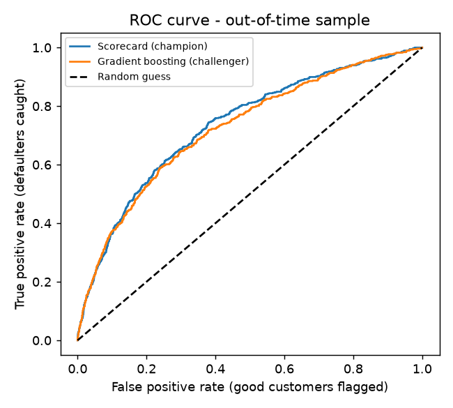
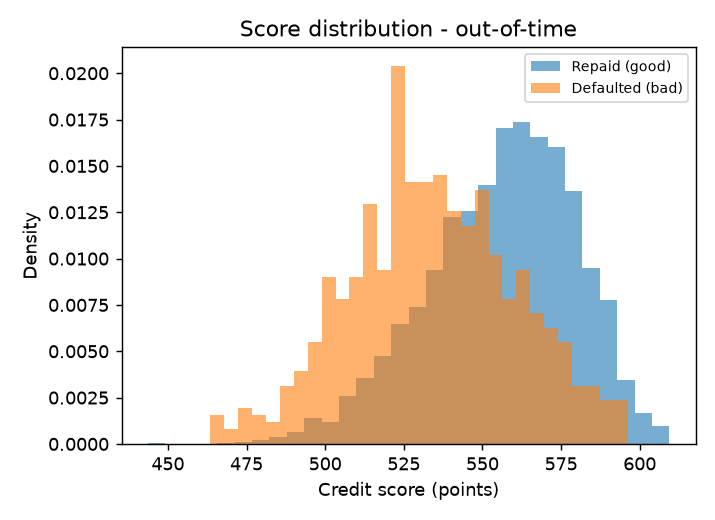
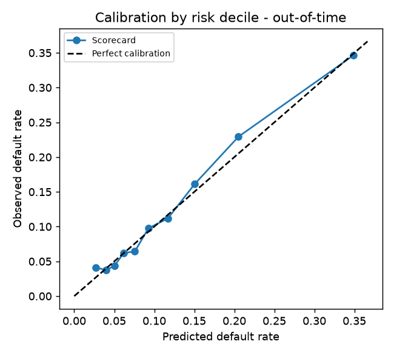
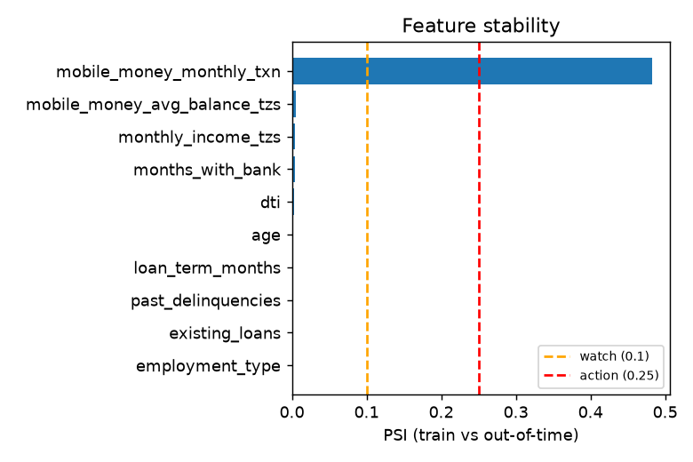

# Independent Model Validation Report - MikopoScore

*Generated 2026-10-21 09:37 | model version 0.1.0 | trained 2026-10-21T09:37:30+00:00*

## Verdict: **PASSED WITH CONDITIONS (synthetic data - not for real lending)**

| check | value | result |
|---|---|---|
| OOT AUC >= 0.7 | 0.735 | PASS |
| AUC drop train->OOT <= 0.05 | -0.001 | PASS |
| Score PSI < 0.25 | 0.004 | PASS |
| abs(mean predicted PD - observed rate) <= 0.03 | 0.003 | PASS |
| Gender impact ratio >= 0.8 | 0.991 | PASS |
| Region impact ratio >= 0.8 | 0.922 | PASS |

**Condition:** significant input drift in `mobile_money_monthly_txn`. The overall score is stable today, but this input has shifted a lot. Review it, monitor it monthly, and refresh the model if the drift persists or spreads to the score.

> Thresholds are this project's own teaching policy (see `config.py`), not any bank's.

## 1. Purpose and scope
The model estimates the **probability of default (PD)** of a loan applicant at application
time. Output is a credit score (600 points = 50:1 good:bad odds, +20 points doubles the odds)
and a decision: approve if PD < 8%, decline if PD >= 20%, otherwise refer to a human.
Model type: Weight-of-Evidence logistic-regression scorecard. Challenger: gradient boosting.

## 2. Data
| sample | rows | default_rate | from | to |
|---|---|---|---|---|
| train | 11378 | 0.121 | 2024-07-01 | 2025-12-31 |
| test | 3793 | 0.121 | 2024-07-01 | 2025-12-31 |
| oot | 4829 | 0.119 | 2026-01-01 | 2026-06-30 |

**Important:** the data is SYNTHETIC. All performance numbers describe a simulator, not real borrowers.

## 3. Discriminatory power
| model | sample | AUC | Gini | KS | Brier |
|---|---|---|---|---|---|
| scorecard | train | 0.734 | 0.467 | 0.351 | 0.096 |
| scorecard | test | 0.713 | 0.426 | 0.312 | 0.099 |
| scorecard | oot | 0.735 | 0.470 | 0.364 | 0.096 |
| challenger | train | 0.786 | 0.571 | 0.431 | 0.090 |
| challenger | test | 0.713 | 0.427 | 0.317 | 0.099 |
| challenger | oot | 0.724 | 0.449 | 0.350 | 0.096 |

**Champion vs challenger:** The challenger does not beat the scorecard on OOT AUC (0.724 vs 0.735) and its AUC falls 0.061 from train to OOT (the scorecard's AUC moves by +0.001). The extra complexity is not justified, so the explainable scorecard stays champion.

## 4. Calibration (out-of-time)
Average predicted PD **0.117** vs observed default rate **0.119** (gap 0.003).

| group | n | predicted_pd | observed_rate | gap |
|---|---|---|---|---|
| 0 | 483 | 0.027 | 0.041 | -0.014 |
| 1 | 484 | 0.040 | 0.037 | 0.002 |
| 2 | 482 | 0.050 | 0.044 | 0.007 |
| 3 | 483 | 0.062 | 0.062 | -0.000 |
| 4 | 483 | 0.076 | 0.064 | 0.011 |
| 5 | 482 | 0.093 | 0.098 | -0.005 |
| 6 | 483 | 0.117 | 0.112 | 0.005 |
| 7 | 483 | 0.151 | 0.161 | -0.011 |
| 8 | 484 | 0.205 | 0.229 | -0.024 |
| 9 | 482 | 0.349 | 0.346 | 0.002 |

## 5. Stability (train vs out-of-time)
Score PSI = **0.004** (stable).

| feature | psi | status |
|---|---|---|
| age | 0.001 | stable |
| monthly_income_tzs | 0.004 | stable |
| dti | 0.002 | stable |
| loan_term_months | 0.001 | stable |
| existing_loans | 0.000 | stable |
| months_with_bank | 0.004 | stable |
| mobile_money_monthly_txn | 0.483 | ACTION |
| mobile_money_avg_balance_tzs | 0.005 | stable |
| past_delinquencies | 0.001 | stable |
| employment_type | 0.000 | stable |

## 6. Fairness screening (gender and region are NOT model inputs)
**Gender** (impact ratio 0.99)

| gender | applications | approval_rate | default_rate_of_approved |
|---|---|---|---|
| F | 2294 | 0.478 | 0.044 |
| M | 2535 | 0.482 | 0.053 |

**Region** (impact ratio 0.92)

| region | applications | approval_rate | default_rate_of_approved |
|---|---|---|---|
| Arusha | 578 | 0.472 | 0.044 |
| Dar es Salaam | 1465 | 0.471 | 0.038 |
| Dodoma | 497 | 0.511 | 0.083 |
| Mbeya | 481 | 0.493 | 0.046 |
| Mwanza | 661 | 0.484 | 0.047 |
| Other | 1147 | 0.476 | 0.051 |

*Caveat:* in this synthetic data gender and region are independent of risk by construction, so
passing is expected. It proves the CHECK works; it does not prove real data would be fair.
Removing a protected attribute from the model does not guarantee fairness, because other
variables can act as proxies. That is why outcomes are tested.

## 7. Limitations and recommendations
1. **Synthetic data.** Re-validate on real data before any real use.
2. **Short history.** The out-of-time sample covers only six months; defaults often take longer to appear.
3. **Reject inference.** Real bank data only contains customers who were approved. This ignores that bias.
4. **Drift.** Income and mobile-money activity grow over time in this dataset; see section 5. Monitor PSI monthly.
5. **Recalibration.** If the calibration gap widens, recalibrate the intercept before rebuilding.
6. **Governance.** Real use needs model documentation, ownership, a change log and an annual review.
